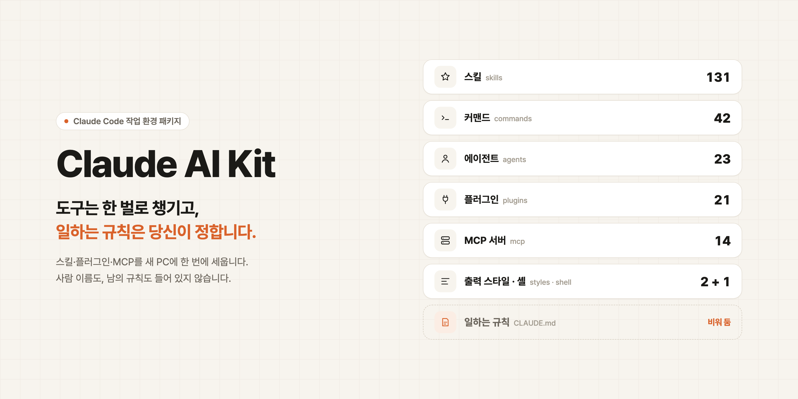
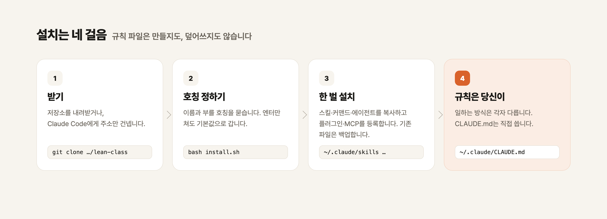

<p align="center">
  
</p>

# Claude AI Kit

**도구는 한 벌로 챙기고, 일하는 규칙은 당신이 정합니다.**

새 PC를 받으면 Claude Code는 빈손입니다. 지난 몇 달 동안 쓰던 스킬, 붙여 두던 플러그인과 MCP, 손에 익은 커맨드가 하나도 없습니다. 이 킷은 그 **도구 한 벌**을 명령 한 줄로 다시 세웁니다.

대신 **일하는 방식(규칙)은 담지 않습니다.** 무엇을 먼저 묻고, 어디까지 맡기고, 언제 멈출지는 사람마다 다릅니다. 남의 규칙을 그대로 옮겨 오면 내 일이 그 사람의 습관을 따라가게 됩니다. 그래서 `~/.claude/CLAUDE.md`는 만들지도, 덮어쓰지도 않습니다. 그 칸은 비워 두고 당신이 채웁니다.

> 사람 이름도 들어 있지 않습니다. 설치할 때 당신의 이름과 부를 호칭을 묻고, 스킬 안의 자리표시를 그 값으로 바꿉니다.

---

## 30초 설치

Claude Code에게 맡기는 것이 가장 쉽습니다.

> `https://github.com/beyondworks/lean-class.git 이 저장소 설치해줘`

직접 하려면 이렇게 합니다.

```bash
git clone https://github.com/beyondworks/lean-class.git
bash lean-class/install.sh
```

이름과 호칭을 묻습니다. **엔터만 쳐도 됩니다.** 끝나면 Claude Code를 다시 시작하고 새 터미널을 여세요.

```bash
bash install.sh --defaults              # 전부 기본값, 묻지 않음
bash install.sh --answers owner.conf    # 파일에서 읽음 (owner.example.conf 참고)
```

<p align="center">
  
</p>

기존 파일은 지우지 않고 `.bak-<타임스탬프>`로 옮겨 둡니다. `rm -rf`는 쓰지 않습니다.

---

## 무엇이 들어 있나

| 칸 | 개수 | 폴더 | 하는 일 |
|---|---:|---|---|
| 스킬 | 131 | `02-skills/` | 일의 순서를 아는 도구. 상세페이지·슬라이드·영상·리서치·자동화 등 |
| 커맨드 | 42 | `03-commands/` | `/`로 부르는 짧은 지시 |
| 에이전트 | 23 | `04-agents/` | 역할을 나눠 맡기는 하위 에이전트 |
| 플러그인 | 21 | `01-plugins/` | 마켓플레이스 6곳에서 일괄 설치 |
| MCP 서버 | 14 | `00-mcp/` | 키가 필요 없는 것은 자동 등록, 필요한 것은 안내 |
| 출력 스타일 | 2 | `09-output-styles/` | 한국어 조사·어미가 떨어지지 않게 하는 스타일 |
| 셸 | 1 | `08-shell/` | `cc` 별칭과 PATH |
| **일하는 규칙** | **0** | — | **비워 둡니다. 당신이 씁니다.** |

### 이번 판에 새로 들어온 스킬

| 스킬 | 한 줄 |
|---|---|
| `lean-polish` | 시각 결과물을 내놓기 전에 균형·여백·글자 배치를 점검하고, 실제 화면에서 한 장씩 본 뒤에야 "됐다"고 말하게 합니다 |
| `design-taste-frontend` | 템플릿 같은 화면을 피하는 웹 디자인 방향 잡기(제3자 저작물, MIT) |

상세페이지 제작, 런칭 영상 제작, 여러 세션을 팀으로 묶는 스킬은 공개용으로 다듬는 중이라 다음 판에 넣습니다.

전체 목록과 판마다 바뀐 내용은 [`PACKAGE_MANIFEST.md`](PACKAGE_MANIFEST.md)에 있습니다.

---

## 담지 않은 것, 그리고 이유

| 담지 않은 것 | 이유 |
|---|---|
| 글로벌 규칙(`CLAUDE.md`, `rules/`)과 작업 하네스 | 일하는 방식은 각자 정합니다. 이 킷은 도구까지만 챙깁니다 |
| 특정 사람의 화법을 배운 스킬 | 이름을 지워도 내용이 그 사람 자체라 치환으로 해결되지 않습니다 |
| 특정 앱·사내 시스템 전용 스킬 | 그 앱이 없으면 쓸모가 없습니다 |
| 실제 작업 결과물과 세션 기록 | 도구 상자이지 작업 일지가 아닙니다 |
| API 키·토큰·개인 경로 | 하나도 없습니다. 키 자리는 `<YOUR_...>`입니다 |

배포 전에는 `scripts/scan-personal.sh`가 이름·고객사·비밀값을 검사합니다. 차단 항목이 0건이어야 내보냅니다.

---

## 설치 후 알아 둘 것

- **MCP 키**: hyperbrowser·magic·testsprite·notion은 본인 키가 필요합니다. `00-mcp/README.md`를 보세요.
- **`cc` 별칭**: `claude --dangerously-skip-permissions`의 줄임입니다. 파일을 쓰거나 명령을 실행하기 전에 묻지 않으니, **믿는 저장소에서만** 쓰세요. 부담스러우면 `~/.claude/lean-class.sh`에서 그 줄을 지우면 됩니다.
- **규칙은 직접**: `~/.claude/CLAUDE.md`에 "이렇게 일해 달라"를 몇 줄 적어 두면, 이 도구들이 그 방식대로 움직입니다.

---

## 구조

```
lean-class/
├── install.sh              ← 한 번에 설치
├── owner.example.conf      ← 묻지 않고 설치할 때 쓰는 답변 예시
├── 00-mcp/ … 09-output-styles/
├── docs/assets/            ← README 그림(원본 HTML은 src/)
└── scripts/
    ├── scan-personal.sh    ← 이름·고객사·비밀값 검사(배포 전 관문)
    └── build-skills.sh     ← 원 소유자 PC에서 스킬·커맨드를 다시 모으는 빌드
```

## 라이선스

이 저장소의 원본 부분은 MIT입니다. 제3자 스킬과 플러그인은 각 폴더의 라이선스를 따릅니다(`design-taste-frontend/LICENSE` 등). 한국어 출력 스타일은 재배포하지 않고 설치할 때 원본 저장소에서 받아옵니다.
